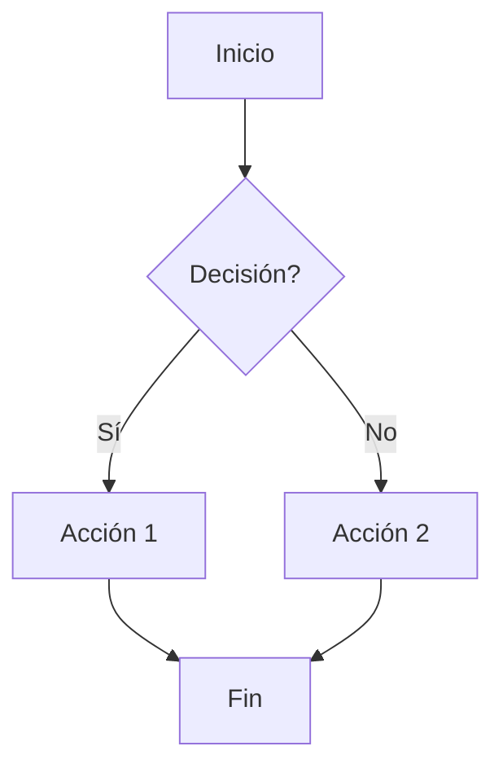

# 🚀 Guía de Inicio Rápido - Documentación HermeX POS

Instrucciones para comenzar a trabajar con la documentación.

## ⚡ Inicio en 5 Minutos

### 1. Instalar Dependencias

```bash
cd "C:\Users\JUANANTONIOCASTILLAO\Herd\pos-backend\_PROJECT_DOCS\Documentacion"

npm install
```

**Tiempo:** ~2 minutos (depende de conexión)

### 2. Iniciar Servidor de Desarrollo

```bash
npm run docs:dev
```

**Salida esperada:**
```
  ➜  Local:   http://localhost:5173/
  ➜  press h + enter to show help
```

### 3. Abrir en el Navegador

- Ir a: **http://localhost:5173/**
- Deberías ver la página principal de documentación

**¡Listo!** Ya tienes la documentación corriendo localmente. 🎉

---

## 📝 Estructura de Carpetas

```
Documentacion/
├── .vitepress/              # Configuración VitePress
│   └── config.ts            # ← Configurar temas, navegación, búsqueda
├── docs/                    # Contenido de documentación
│   ├── index.md             # Página principal
│   ├── manual-usuario/
│   ├── manual-tecnico/
│   ├── operaciones/
│   └── procesos-negocio/
├── public/                  # Archivos estáticos
│   ├── screenshots/         # ← Agregar capturas aquí
│   ├── diagrams/           # ← Agregar diagramas aquí
│   └── videos/
└── package.json
```

---

## ✍️ Escribir Documentación

### Crear una Página Nueva

#### Paso 1: Crear archivo Markdown

```bash
# Ejemplo: crear página para role Administrador
touch docs/manual-usuario/roles/administrador.md
```

#### Paso 2: Escribir contenido

```markdown
# Manual del Administrador

Descripción general...

## Sección 1
Contenido...

## 🔗 Recursos Relacionados
- [Otra página](../otra)

---

**Última actualización:** 2026-04-08
```

#### Paso 3: Agregar a la navegación

Editar `.vitepress/config.ts` y agregar entrada en el sidebar correspondiente:

```typescript
{
  text: 'Administrador',
  link: '/manual-usuario/roles/administrador'
}
```

#### Paso 4: Guardar y verificar

- El sitio se recarga automáticamente
- Busca tu página en el sitio
- ¡Verifica que se vea bien!

---

## 🎨 Sintaxis Markdown Común

### Encabezados
```markdown
# Encabezado 1
## Encabezado 2
### Encabezado 3
```

### Énfasis
```markdown
**texto en negrita**
*texto en cursiva*
~~texto tachado~~
```

### Listas
```markdown
- Elemento 1
- Elemento 2
  - Sub-elemento 2.1

1. Primer elemento
2. Segundo elemento
```

### Código
```markdown
`código inline`

```javascript
console.log('código en bloque');
```
```

### Tablas
```markdown
| Columna 1 | Columna 2 |
|-----------|-----------|
| Valor 1   | Valor 2   |
| Valor 3   | Valor 4   |
```

### Links
```markdown
[Texto del link](../ruta-relativa)
[Link externo](https://ejemplo.com)
```

### Callouts (Cuadros destacados)
```markdown
:::info
Información importante
:::

:::warning
Advertencia
:::

:::danger
Peligro
:::

:::details Haz click para expandir
Contenido oculto
:::
```

---

## 📊 Agregar Diagramas

### Usar Mermaid.js

```markdown
## Diagrama de Flujo


```

### Tipos de Diagramas
- `graph` - Flujos y arquitectura
- `sequenceDiagram` - Interacción entre componentes
- `gantt` - Cronogramas
- `classDiagram` - Diagramas de clases

[Referencia Mermaid](https://mermaid.js.org/)

---

## 📸 Agregar Capturas de Pantalla

### 1. Capturar Screenshot

Usar ShareX o herramienta nativa del SO:
- **Windows:** Win+Shift+S
- **Mac:** Cmd+Shift+5
- **Linux:** Cmd+PrtScn

### 2. Guardar en `public/screenshots/`

```
Documentacion/public/screenshots/
├── pos/
│   ├── pantalla-principal.png
│   └── buscar-producto.png
└── inventario/
    └── ajuste-stock.png
```

### 3. Referenciar en Markdown

```markdown


*Figura: Interface del Punto de Venta*
```

---

## 🔍 Búsqueda en Documentación

### Búsqueda Local
- Presionar `Ctrl+K` (o `Cmd+K` en Mac)
- Escribir término a buscar
- Los resultados se muestran en tiempo real

La búsqueda indexa automáticamente todo el contenido.

---

## 🏗️ Build para Producción

### Generar Sitio Estático

```bash
npm run docs:build
```

**Genera:** Carpeta `dist/` con archivos listos para producción

### Previsualizar Build

```bash
npm run docs:preview
```

Accede a: **http://localhost:4173/**

---

## 🐛 Troubleshooting

### Problema: El sitio no carga

```bash
# Limpiar cache
rm -rf node_modules
rm package-lock.json

# Reinstalar
npm install

# Iniciar de nuevo
npm run docs:dev
```

### Problema: Los cambios no se reflejan

- Verificar que el archivo se guardó
- Revisar la consola por errores
- Refrescar el navegador (Ctrl+F5)

### Problema: Errores de Markdown

VitePress mostrará errores si el Markdown tiene sintaxis inválida. Revisar la consola para detalles.

---

## 📚 Estructura Recomendada por Página

```markdown
# Título Descriptivo

Párrafo introductorio explicando el propósito de la página.

## Descripción General

Explicación más detallada...

## 🎯 Casos de Uso

- Caso 1
- Caso 2

## 📋 Procedimiento Paso a Paso

1. Primer paso
2. Segundo paso
3. Tercer paso

### Ejemplo
```código
```

## ⚠️ Consideraciones Importantes

- Punto 1
- Punto 2

## 🔗 Recursos Relacionados

- [Página relacionada 1](link)
- [Página relacionada 2](link)

## ❓ FAQ

**Pregunta 1?**
Respuesta...

**Pregunta 2?**
Respuesta...

---

**Última actualización:** 2026-04-08  
**Versión:** 1.0.0
```

---

## 🚢 Despliegue en Producción

### GitHub Pages (Gratuito)

1. Crear repositorio en GitHub
2. Configurar branch `gh-pages`
3. Crear `.github/workflows/deploy.yml`:

```yaml
name: Deploy Docs

on:
  push:
    branches:
      - main

jobs:
  build:
    runs-on: ubuntu-latest
    steps:
      - uses: actions/checkout@v3
      - uses: actions/setup-node@v3
        with:
          node-version: '18'
      - run: npm install
      - run: npm run docs:build
      - uses: peaceiris/actions-gh-pages@v3
        with:
          github_token: ${{ secrets.GITHUB_TOKEN }}
          publish_dir: ./dist
```

4. Los cambios en `main` se desplieguen automáticamente

### Servidor Personalizado

```bash
# Build
npm run docs:build

# Copiar a servidor
scp -r dist/* usuario@servidor:/var/www/docs.hermexpos.app

# Configurar nginx
# /etc/nginx/sites-available/docs.hermexpos.app
```

---

## 📊 Próximos Pasos

### Fase 2: Manual de Usuario (Próxima)

- [ ] Crear `docs/manual-usuario/instalacion.md`
- [ ] Crear guides por rol (administrador, cajero, etc.)
- [ ] Crear guías de módulos
- [ ] Agregar capturas de pantalla
- [ ] Crear flujos de trabajo

### Fase 3: Manual Técnico

- [ ] Documentar arquitectura backend
- [ ] Documentar arquitectura frontend
- [ ] Crear diagramas ERD
- [ ] Generar API docs con Scribe

---

## 📞 Ayuda

### Documentación de VitePress
- https://vitepress.dev/

### Documentación de Markdown
- https://www.markdownguide.org/

### Documentación de Mermaid
- https://mermaid.js.org/

---

**Documento creado:** 2026-04-08  
**Versión:** 1.0.0
