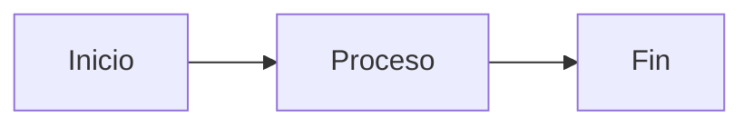

# 📚 HermeX POS - Documentación Completa

Sitio de documentación profesional del sistema de punto de venta HermeX POS.

## 📖 Contenido

Esta documentación contiene:

- **Manual de Usuario** (90-120 págs) - Guías operativas por rol
- **Manual Técnico** (70-80 págs) - Arquitectura, API, base de datos
- **Manual de Operaciones** (40-50 págs) - Despliegue, backup, seguridad
- **Procesos de Negocio** (30-40 págs) - Flujos con diagramas

**Total:** 260+ páginas de documentación profesional

## 🚀 Inicio Rápido

### Instalación

```bash
# 1. Instalar dependencias
npm install

# 2. Iniciar servidor de desarrollo
npm run docs:dev

# 3. Abre en el navegador
# http://localhost:5173
```

### Build para Producción

```bash
# Generar sitio estático
npm run docs:build

# Vista previa del build
npm run docs:preview
```

## 📁 Estructura del Proyecto

```
documentacion/
├── .vitepress/
│   └── config.ts                 # Configuración de VitePress
├── docs/
│   ├── index.md                  # Página principal
│   ├── manual-usuario/
│   │   ├── index.md
│   │   ├── instalacion.md
│   │   ├── roles/               # Guías por rol
│   │   ├── modulos/             # Guías por módulo
│   │   └── flujos/              # Flujos de trabajo
│   ├── manual-tecnico/
│   │   ├── index.md
│   │   ├── arquitectura/
│   │   ├── api/
│   │   ├── database/
│   │   ├── frontend/
│   │   ├── development/
│   │   └── security/
│   ├── operaciones/
│   │   ├── index.md
│   │   ├── deployment/
│   │   ├── administracion/
│   │   ├── performance/
│   │   └── security/
│   └── procesos-negocio/
├── public/
│   ├── screenshots/              # Capturas de pantalla
│   ├── diagrams/                 # Diagramas exportados
│   └── videos/                   # Videos tutoriales
├── package.json
├── README.md
└── .gitignore
```

## 🛠️ Tecnologías Utilizadas

- **VitePress** v1.0+ - Generador de sitio estático
- **Vue 3** - Framework de UI
- **Mermaid.js** - Diagramas en Markdown
- **Markdown** - Formato de contenido

## 📝 Convenciones de Contenido

### Estructura de Archivos
- Todos los documentos están en Markdown (.md)
- Nombres de archivo en snake_case
- Organización jerárquica con index.md en cada carpeta

### Formateo Markdown
- Encabezados: `#` para título, `##` para secciones
- Emojis: Usar al inicio de títulos cuando sea apropiado
- Tablas: Para datos estructurados
- Código: \`\`\`language para bloques de código
- Links: [texto](ruta) para enlaces internos

### Diagramas
- Usar Mermaid.js para flujos y arquitectura
- Documentos específicos para diagramas complejos
- Alternativa: Capturas de dbdiagram.io para ERDs

## 📊 Fase 1: Infraestructura (Completada)

✅ **Tareas realizadas:**
- [x] Estructura de carpetas creada
- [x] Configuración de VitePress
- [x] Integración de Mermaid.js
- [x] Páginas índice para cada sección
- [x] Configuración de navegación
- [x] Configuración de búsqueda
- [x] .gitignore y documentación base

**Próximas fases:**
- Fase 2: Manual de Usuario (90 horas)
- Fase 3: Manual Técnico (70 horas)
- Fase 4: Manual de Operaciones (40 horas)
- Fase 5: Procesos de Negocio (24 horas)
- Fase 6: Revisión y Publicación (20 horas)

## 🔧 Desarrollo de Documentación

### Agregar una Página Nueva

1. Crear archivo `.md` en la carpeta apropiada
2. Agregar entrada en `.vitepress/config.ts` (sidebar)
3. Escribir contenido con Markdown
4. Probar en desarrollo: `npm run docs:dev`

### Estructura de Página Recomendada

```markdown
# Título de la Página

Descripción breve del contenido.

## Sección 1
Contenido...

## Sección 2
Contenido...

## 🔗 Recursos Relacionados
- [Otra página](../otra-pagina)

---

**Última actualización:** 2026-04-08  
**Versión:** 1.0.0
```

### Usar Diagramas Mermaid

```markdown
## Ejemplo de Diagrama


```

## 📸 Captura de Pantallas

- Ubicación: `public/screenshots/`
- Formato: PNG (optimizado)
- Nombre: descriptivo en snake_case
- Incluir: Anotaciones si es necesario

### Referenciar Capturas

```markdown

```

## 📦 Dependencias

### Instaladas
- vitepress: Generador de sitio
- vitepress-plugin-mermaid: Soporte para diagramas
- mermaid: Motor de diagramas

### Para Instalar (Fases Futuras)

```bash
# Si necesitas otras dependencias
npm install <nombre-paquete>
```

## 🔄 Flujo de Actualización

1. **Desarrollo:** Escribir en rama de feature
2. **Testing:** `npm run docs:build` y revisar localmente
3. **PR:** Solicitar revisión
4. **Merge:** Combinar a main
5. **Despliegue:** CI/CD automatizado a producción

## 🚀 Despliegue

### GitHub Pages (Opción 1)

```bash
# Configurar github action para despliegue automático
# Ver .github/workflows/docs.yml
```

### docs.hermexpos.app (Opción 2)

```bash
# Desplegar a servidor personalizado
# npm run docs:build
# scp -r dist/* user@host:/var/www/docs.hermexpos.app
```

## 📞 Contribución y Feedback

### Reportar Errores
- Crear issue en GitHub
- Describir el problema
- Incluir página afectada

### Sugerir Mejoras
- Abrir discussion en GitHub
- Explicar el beneficio
- Ser específico

### Contribuir Contenido
- Fork del repositorio
- Crear rama de feature
- Escribir contenido siguiendo convenciones
- PR con descripción clara

## 📄 Licencia

Copyright © 2024-2026 HermeX. Todos los derechos reservados.

## 🔗 Enlaces Útiles

- **Aplicación:** http://localhost:3000 (desarrollo)
- **API Backend:** http://localhost:8000/api (desarrollo)
- **Repositorio Backend:** https://github.com/hermexpos/backend
- **Repositorio Frontend:** https://github.com/hermexpos/frontend

## 📋 Checklist de Fase 1

- [x] Crear estructura de carpetas
- [x] Instalar y configurar VitePress
- [x] Crear archivo de configuración `.vitepress/config.ts`
- [x] Integrar Mermaid.js para diagramas
- [x] Crear página principal (index.md)
- [x] Crear índices de cada sección
- [x] Configurar barra lateral de navegación
- [x] Configurar búsqueda local
- [x] Crear .gitignore
- [x] Documentar proceso de desarrollo

**Estado:** ✅ Fase 1 Completada

---

**Documentación creada:** 2026-04-08  
**Versión:** 1.0.0  
**Próxima fase:** Manual de Usuario (Fase 2)
