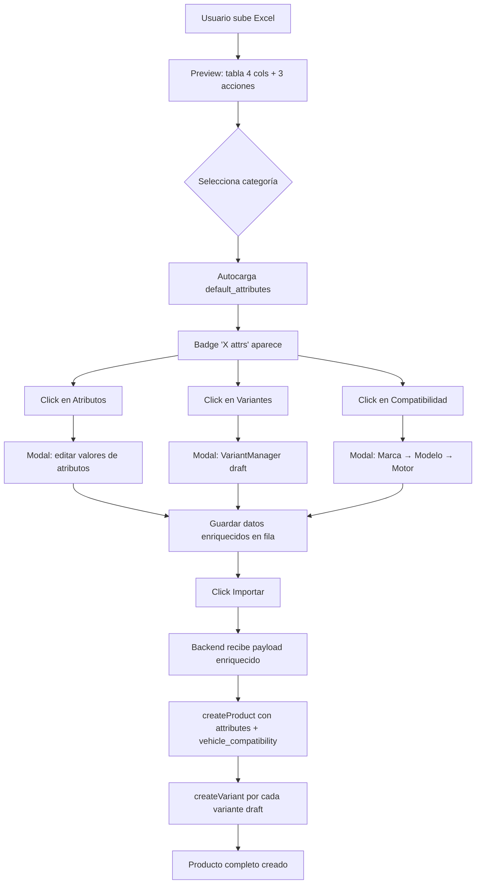

# Plan: Importador de Productos V2 — Atributos, Variantes y Compatibilidad Vehicular

**Fecha**: 2026-04-21  
**Estado**: Aprobado

---

## 1. Resumen

Evolucionar el importador de productos de una tabla plana de 6 columnas a un sistema con:
- **4 columnas editables** en tabla (nombre, sku, descripcion, categoria)
- **3 columnas de acción** con modales grandes (atributos, variantes, compatibilidad vehicular)
- **Modal de categoría mejorado** con soporte para `default_attributes`
- **Autocarga de atributos** al seleccionar categoría
- Se **eliminan costo y precio** de la tabla (pasan a variantes)

---

## 2. Decisiones de Diseño

| Decisión | Respuesta |
|----------|-----------|
| Modal vs Drawer para detalle fila | **Modal grande** (estilo `VariantManager`) |
| Autocargar atributos al seleccionar categoría | **Sí** — vía `GET /categories/{id}` |
| Costo/Precio en tabla | **No** — se mueven dentro de cada variante |

---

## 3. UX — Tabla Principal

```
| #  | Nombre*     | SKU    | Descripción | Categoría*(+) | Atributos   | Variantes    | Compatibilidad | Estado |
|----|-------------|--------|-------------|---------------|-------------|--------------|----------------|--------|
| 1  | Bujía...    | BJ-001 | Motor gas.. | Encendido ▼   | [3 attrs ✎] | [1 var ✎]    | [2 motores ✎]  | ✓ OK   |
| 2  | Filtro...   | FL-002 | Universal   | Filtros ▼     | [0 attrs +] | [0 var +]    | [0 compat +]   | ✓ OK   |
```

- Columnas base: inputs/searchable editables directamente en tabla
- Columnas de acción: badge con conteo + botón que abre modal grande
- Al cambiar categoría → autocarga `default_attributes` en `row.__attributes`

---

## 4. Estructura de Datos por Fila

```typescript
interface ImportRow {
    // Datos del Excel (editables en tabla)
    nombre: string
    sku?: string
    descripcion?: string
    categoria: string | number  // nombre o ID

    // Datos enriquecidos (editables via modales)
    __attributes: { name: string, value: string, unit?: string }[]
    __variants: DraftVariant[]  // misma estructura que VariantManager draft
    __compatibility: { engine_id: number, make: string, model: string, engine: string }[]

    // Metadatos internos
    __row: number
    __valid: boolean
    __errors: string[]
}
```

---

## 5. Cambios por Archivo

### 5.1 Backend

#### `app/Imports/ProductImport.php`

| Método | Cambio |
|--------|--------|
| `getColumns()` | Eliminar `costo` y `precio` → quedan 4 columnas |
| `getExampleRow()` | Eliminar `costo` y `precio` |
| `mapHeader()` | Eliminar mapeos de `costo`/`precio` |
| `validateRow()` | Eliminar validación de precio/costo negativos |
| `processRow()` | Eliminar bloque de pricing. Aceptar `__attributes`, `__variants`, `__compatibility` del payload. Pasar `attributes` y `vehicle_compatibility` a `createProduct()`. Crear variantes post-producto via loop de `ProductService::createVariant()` |

**processRow() nuevo (pseudocódigo):**
```php
public function processRow(array $row): mixed
{
    $categoryId = $this->resolveOrCreate(Category::class, 'name', $row['categoria']);

    $productData = [
        'name'        => $row['nombre'],
        'sku_base'    => $this->nullIfEmpty($row['sku'] ?? null),
        'description' => $this->nullIfEmpty($row['descripcion'] ?? null),
        'category_id' => $categoryId,
        'status'      => 'active',
    ];

    // Atributos enriquecidos del frontend
    if (!empty($row['__attributes'])) {
        $productData['attributes'] = $row['__attributes'];
    }

    // Compatibilidad vehicular
    if (!empty($row['__compatibility'])) {
        $productData['vehicle_compatibility'] = array_column($row['__compatibility'], 'engine_id');
    }

    $product = $this->productService->createProduct($productData);

    // Variantes enriquecidas
    if (!empty($row['__variants'])) {
        foreach ($row['__variants'] as $variantData) {
            $this->productService->createVariant($product, [
                'brand_id' => $variantData['brand_id'],
                'sku'      => $variantData['sku'] ?? '',
                'status'   => 'active',
                'is_default' => false,
            ]);
            // + pricing si viene en variantData['pricing']
        }
    }

    return $product;
}
```

#### `app/Exports/ProductImportTemplate.php`

- `headings()` → `['nombre', 'sku', 'descripcion', 'categoria']`
- `array()` → 2 filas de ejemplo con solo 4 columnas

---

### 5.2 Frontend — Tipos e Infraestructura

#### `resources/js/services/import.ts`

Agregar a `ImportColumn`:
```typescript
export interface ImportColumn {
    // ... existentes ...
    creatable?: boolean
    actionType?: 'attributes' | 'variants' | 'compatibility'
}
```

---

### 5.3 Frontend — UniversalImporter

#### `resources/js/components/Import/UniversalImporter.vue`

**Cambios en script:**
- Inicializar `__attributes: []`, `__variants: []`, `__compatibility: []` en cada fila del preview
- Nuevo emit: `'row-action'` con `(actionType, rowIdx)`
- Agregar watcher: cuando `row.categoria` cambia (en columna searchable), emitir `'category-changed'` con `(rowIdx, categoryId)`
- Modificar `runImport()`: incluir `__attributes`, `__variants`, `__compatibility` en el payload

**Cambios en template — columnas de acción:**
```vue
<!-- Después de las columnas editables normales -->
<td v-for="action in actionColumns" :key="action.key" class="px-1 py-1 text-center">
    <button @click="emit('row-action', action.actionType, rowIdx)"
        class="inline-flex items-center gap-1 px-2 py-1 text-xs rounded-md
               border border-gray-200 hover:border-blue-400 hover:bg-blue-50
               dark:border-border dark:hover:border-blue-600 dark:hover:bg-blue-900/20">
        <span class="font-medium">{{ getActionCount(row, action.actionType) }}</span>
        <span class="text-gray-500">{{ action.label }}</span>
    </button>
</td>
```

---

### 5.4 Frontend — Import.vue (Página Principal)

#### `resources/js/pages/Products/Import.vue`

Este archivo crece significativamente (~400 líneas). Estructura:

**Script setup:**
```
1. Imports (Vue, componentes, API, tipos)
2. importConfig con 4 columnas base + 3 actionColumns
3. Estado de modales (categoryModal, attributesModal, variantsModal, compatModal)
4. Estado compartido (categorías, marcas de vehículos, etc.)
5. Handlers para eventos del UniversalImporter
6. Lógica de autocarga de atributos por categoría
7. Submit handlers para cada modal
```

**Template:**
```
1. <UniversalImporter> con eventos @row-action, @category-changed, @create
2. Modal: Nueva Categoría (con sección de atributos por defecto)
3. Modal: Editar Atributos de Fila
4. Modal: Variantes de Fila (VariantManager embebido en draft mode)
5. Modal: Compatibilidad Vehicular de Fila (selector marca→modelo→motor)
```

#### Modal 1: Nueva Categoría (mejorado)

```vue
<Dialog>
  <DialogContent class="sm:max-w-lg">
    <DialogTitle>Nueva Categoría</DialogTitle>
    <form @submit.prevent="submitCategory">
      <!-- Nombre -->
      <Label>Nombre *</Label>
      <Input v-model="categoryForm.name" required />

      <!-- Categoría padre -->
      <SearchableSelect :options="categoryOptions" v-model="categoryForm.parent_id" />

      <!-- Atributos por defecto -->
      <h3>Atributos por defecto</h3>
      <div v-for="(attr, i) in categoryForm.default_attributes">
        <Input v-model="attr.name" placeholder="Nombre" />
        <Checkbox v-model="attr.required" label="Requerido" />
        <button @click="removeAttr(i)">✕</button>
      </div>
      <button @click="addAttr">+ Agregar atributo</button>

      <Button type="submit">Guardar</Button>
    </form>
  </DialogContent>
</Dialog>
```

Payload al backend:
```json
{
    "name": "Encendido",
    "parent_id": null,
    "default_attributes": [
        { "name": "Amperaje", "required": true },
        { "name": "Voltaje", "required": false }
    ]
}
```

#### Modal 2: Editar Atributos de Fila

```vue
<Dialog>
  <DialogContent class="sm:max-w-lg">
    <DialogTitle>Atributos — Fila {{ editingRowIdx + 1 }}</DialogTitle>
    <div v-for="(attr, i) in currentRowAttributes">
      <div class="grid grid-cols-3 gap-2">
        <Input v-model="attr.name" placeholder="Nombre" />
        <Input v-model="attr.value" placeholder="Valor" />
        <Input v-model="attr.unit" placeholder="Unidad" />
      </div>
    </div>
    <button @click="addAttribute">+ Agregar</button>
    <Button @click="saveAttributes">Guardar</Button>
  </DialogContent>
</Dialog>
```

- Se pre-pobla con `default_attributes` de la categoría seleccionada (valores vacíos)
- El usuario llena los valores

#### Modal 3: Variantes de Fila

```vue
<Dialog>
  <DialogContent class="sm:max-w-4xl max-h-[90vh] overflow-y-auto">
    <DialogTitle>Variantes — Fila {{ editingRowIdx + 1 }}</DialogTitle>
    <VariantManager
      :category-id="getRowCategoryId(editingRowIdx)"
      :sku-base="editedRows[editingRowIdx]?.sku"
      :product-name="editedRows[editingRowIdx]?.nombre"
      @draft-variants-changed="onVariantsChanged"
    />
  </DialogContent>
</Dialog>
```

- `VariantManager` **ya funciona en modo draft** (sin `productId`) — emite `draft-variants-changed`
- Se almacena en `row.__variants`

#### Modal 4: Compatibilidad Vehicular de Fila

```vue
<Dialog>
  <DialogContent class="sm:max-w-3xl max-h-[90vh] overflow-y-auto">
    <DialogTitle>Compatibilidad — Fila {{ editingRowIdx + 1 }}</DialogTitle>
    <!-- Reutilizar la lógica de Create.vue: marca → modelo → motor/chasis -->
    <SearchableSelect :options="makeOptions" v-model="selectedMakeId" />
    <SearchableSelect :options="modelOptions" v-model="selectedModelId" />
    <!-- Lista de motores con checkboxes -->
    <!-- Tabla de compatibilidades agregadas -->
  </DialogContent>
</Dialog>
```

- Se extrae la lógica de compatibilidad vehicular de Create.vue a un composable reutilizable (`useVehicleCompatibility`)
- Se almacena en `row.__compatibility`

---

### 5.5 Frontend — Nuevo Composable (Opcional pero Recomendado)

#### `resources/js/composables/useVehicleCompatibility.ts` [NEW]

Extraer de Create.vue la lógica compartida:
```typescript
export function useVehicleCompatibility() {
    // Estado
    const selectedMakeId = ref<number | null>(null)
    const selectedModelId = ref<number | null>(null)
    const vehicleMakes = ref([])
    const vehicleModels = ref([])
    const vehicleEngines = ref([])
    const selectedEngineIds = ref<number[]>([])
    const addedEngines = ref([])

    // Watchers (make → models, model → engines)
    // Métodos (fetchMakes, addEngines, removeEngine)

    return { selectedMakeId, selectedModelId, ... }
}
```

---

## 6. Flujo Completo



---

## 7. Orden de Implementación

### Fase 1: Backend (simplificar)
1. `ProductImportTemplate.php` → 4 columnas
2. `ProductImport.php` → eliminar costo/precio, aceptar payload enriquecido

### Fase 2: Frontend infraestructura
3. `import.ts` → agregar `actionType` a `ImportColumn`
4. `UniversalImporter.vue` → columnas de acción, inicializar `__attributes`/`__variants`/`__compatibility`, emit `row-action` y `category-changed`

### Fase 3: Frontend modales
5. `Import.vue` → Modal categoría mejorado (con atributos)
6. `Import.vue` → Modal atributos por fila + autocarga
7. `Import.vue` → Modal variantes (VariantManager draft)
8. `Import.vue` → Modal compatibilidad vehicular

### Fase 4: Composable (refactor)
9. `useVehicleCompatibility.ts` → extraer lógica compartida de Create.vue

### Fase 5: Verificación
10. Tests manuales del flujo completo
11. `php artisan test tests/Feature/P1` para regresión

---

## 8. Archivos Afectados

| Archivo | Acción | Repo |
|---------|--------|------|
| `app/Imports/ProductImport.php` | MODIFY | backend |
| `app/Exports/ProductImportTemplate.php` | MODIFY | backend |
| `resources/js/services/import.ts` | MODIFY | frontend |
| `resources/js/components/Import/UniversalImporter.vue` | MODIFY | frontend |
| `resources/js/pages/Products/Import.vue` | MODIFY (mayor) | frontend |
| `resources/js/composables/useVehicleCompatibility.ts` | NEW | frontend |
